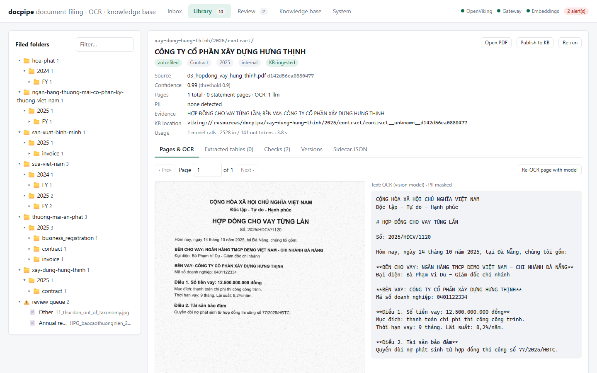
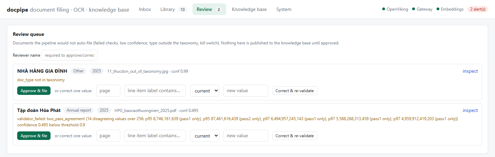
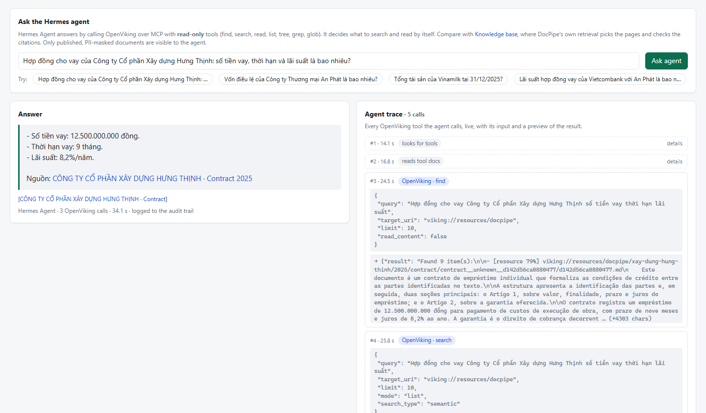
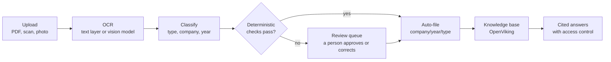
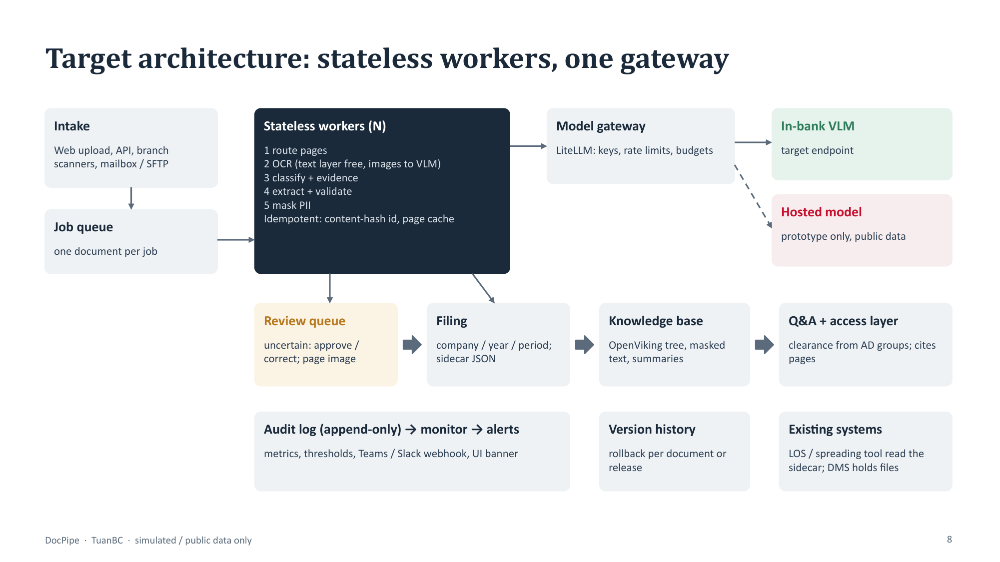

# DocPipe

**Turn the scans in a corporate credit file into filed, checked and searchable documents.**


DocPipe is a working prototype built for the **Techcombank AI Transformation Expert Challenge 2026**
(Problem Bank #2, document processing, and #5, trusted knowledge assistant).
A vision model reads each document; deterministic checks, a review queue and an audit trail decide what is trusted.



---

## Contents

- [Why DocPipe](#why-docpipe)
- [What it does](#what-it-does)
- [How it works](#how-it-works)
- [Quick start](#quick-start)
- [Results at a glance](#results-at-a-glance)
- [Challenge deliverables](#challenge-deliverables)
- [Project structure](#project-structure)
- [Usage reference](#usage-reference)
- [Status and limitations](#status-and-limitations)
- [Data and privacy](#data-and-privacy)
- [Adapting it to other documents](#adapting-it-to-other-documents)
- [License and author](#license-and-author)

## Why DocPipe

A corporate credit file is a pile of documents: financial statements, business registrations, contracts, invoices,
board resolutions, collateral papers. Most arrive as scans or phone photos. Today someone reads each one, renames it,
files it in a shared drive and re-keys the numbers that matter.

That costs hours per borrower, a keyed number cannot be traced back to its page, and finding the same document again
means asking a colleague. DocPipe does the reading and filing, and keeps every value linked to its source.

The full problem statement, options and business case are in the
[decision memo](docs/decision-memo.md).

## What it does

- **Reads any document**: scanned PDFs, phone photos and text PDFs (pages with a text layer are read for free).
- **Sorts and files it**: works out the type, the customer and the year, then files it under
  `company / year / type` with a sidecar JSON of extracted fields.
- **Checks before trusting**: balance-sheet identities, cross-statement tie-outs, "is this number really printed on the
  page", "does this company name really appear". Anything uncertain goes to a person.
- **Answers questions with citations**: staff ask in Vietnamese and get an answer that links to the exact page, or a
  refusal when the documents don't say.
- **Works with agents**: an **Agent** tab runs [Hermes Agent](https://github.com/NousResearch/hermes-agent) against the
  same knowledge base over MCP, with read-only tools and a live trace of every call it makes.
- **Stays governable**: every model call and decision is in an audit log; monitoring raises alerts; a kill switch sends
  everything to review; any filed version can be rolled back.





## How it works



How a document is decided, step by step:

1. **Route.** Statement pages are found by title keywords and numeric density; image-only pages get a cheap
   low-resolution model call.
2. **Read.** The vision model transcribes each page; statement pages also return line items with current and prior values.
3. **Check.** Accounting identities, units, tie-outs between statements, and every number must appear in the page text.
   Scans without a text layer get a second, independent read that must agree.
4. **Score.** Each failed check halves the confidence.
5. **Decide.** Below the threshold, outside the taxonomy, or kill switch on: the document goes to review.
   Otherwise it is filed automatically.
6. **Publish.** Only filed documents (automatic or approved) reach the knowledge base, with personal data masked.

More detail, including the three key design decisions and their trade-offs, is in
[docs/architecture.md](docs/architecture.md).



## Quick start

### Prerequisites

- Windows 10/11 (the start script is PowerShell; the Python code is cross-platform)
- [uv](https://docs.astral.sh/uv/) (installs Python 3.14 and dependencies for you)
- A model endpoint behind LiteLLM. The development route is a ChatGPT login:
  `uv run --group gateway python scripts/chatgpt_login.py`

### Run it

```powershell
# 1. Install dependencies
uv sync --group gateway --group kb

# 2. Start the gateway, knowledge base and web UI
powershell -ExecutionPolicy Bypass -File scripts/start_services.ps1

# 3. Open the app
start http://127.0.0.1:8800
```

Stop everything with `scripts/start_services.ps1 -Stop`.

### Try it

1. In **Inbox**, drop a file from [`data/samples/`](data/samples), for example the registration certificate
   `dkkd_an_phat.png`.
2. Watch the job log as the document is read, checked and filed.
3. Open it in **Library** to see the page image next to the extracted text.
4. Ask a question in **Knowledge base** and click the citation to open the source page.
5. Ask the same question in **Agent** to watch Hermes Agent search and read OpenViking by itself
   (needs [Hermes Agent](https://github.com/NousResearch/hermes-agent) installed; see
   [development notes](docs/development-notes.md#hermes-agent-tab)).

## Results at a glance

Measured on small samples: 16 synthetic scans with deliberate traps, and real public filings from three issuers.

| What was measured | Result |
|---|---|
| Document type, customer and year (16 synthetic scans) | **16 / 16** correct |
| Printed amounts and codes read exactly | **106 / 106** |
| Wrong results filed automatically | **0** |
| Injected errors in real statements sent to review | **6 / 6** |
| Answerable questions correct with a page citation | **31 / 31** (6 / 6 unanswerable refused) |
| Cost and time per document | **$0.0013**, about **13 s** |

Failure cases matter as much as the scores: the model once invented a table header, and new statement layouts
produced false alarms. Both are written up in [docs/eval-results.md](docs/eval-results.md).

## Challenge deliverables

| Brief item | Where |
|---|---|
| Decision memo and business case | [`docs/decision-memo.md`](docs/decision-memo.md) · workbook [`model/business_case.xlsx`](model/business_case.xlsx) |
| Working prototype and demo | This repository · demo video shared separately (subtitles: [`submission/DocPipe_demo.srt`](submission/DocPipe_demo.srt)) |
| Architecture and evaluation | [`docs/architecture.md`](docs/architecture.md) · [`docs/eval-results.md`](docs/eval-results.md) |
| Automation and rollout plan | [`docs/rollout-and-automation.md`](docs/rollout-and-automation.md) · [`docs/adoption-guide.md`](docs/adoption-guide.md) |
| AI log and reflection | [`docs/ai-log.md`](docs/ai-log.md) |
| Presentation | [`slides/DocPipe_deck.pptx`](slides/DocPipe_deck.pptx) · live-demo runbook [`docs/demo-script.md`](docs/demo-script.md) |
| Stakeholders | [`docs/stakeholder-research.md`](docs/stakeholder-research.md) · [`docs/stakeholders.md`](docs/stakeholders.md) · [`docs/interview-notes.md`](docs/interview-notes.md) |

Print-ready PDFs of all of the above are in [`submission/`](submission/README.md).

## Project structure

```text
docpipe/            the pipeline: OCR, classification, validators, filing, governance, KB adapters, CLI
  web/              FastAPI app and the single-page UI (port 8800)
  hermes.py         bridge to Hermes Agent for the Agent tab (isolated profile, read-only OpenViking MCP)
config/             pipeline.yaml: taxonomy, thresholds, model, KB, monitoring
evals/              evaluation harnesses and the synthetic labelled set generator
  results/          key evaluation outputs
tests/              offline unit tests
data/samples/       small synthetic scans of fictional companies, for trying the app
deploy/             LiteLLM, OpenViking and Hermes Agent configs; container files (written, not run)
services/           embedding shim used by OpenViking
scripts/            service start-up, sample generation, demo recording, PDF build
model/              business-case workbook and the script that builds it
slides/             presentation source (slides/build.js) and the built deck
docs/               memo, architecture, evaluation, rollout, stakeholders, AI log
submission/         the PDFs and files sent with the submission
```

## Usage reference

The web UI covers the whole flow. Everything is also available from the command line.

<details>
<summary><b>Command line</b></summary>

All commands run as `uv run --group gateway python -m docpipe <command>`.

**Process documents**

```bash
docpipe run data/raw/<file>.pdf              # process and file; idempotent, --force re-runs
docpipe ocr data/samples/dkkd_an_phat.png    # OCR only (--out x.md to save)
```

**Review**

```bash
docpipe review list
docpipe review approve <doc_id> --reviewer NAME
docpipe review correct <doc_id> --page 108 --label "text in the row" \
        --field current --value 511184 --reviewer NAME     # fix one value, re-check, re-file
```

**Knowledge base**

```bash
docpipe ask "Tổng tài sản của ... năm 2025?" [--clearance restricted] [--backend local|openviking]
docpipe kb sync all | kb status | kb tree | kb search "<query>"
```

**Operations**

```bash
docpipe serve                                    # web UI on :8800
docpipe monitor [--watch]                        # metrics and alerts
docpipe kill on|off                              # kill switch: everything goes to review
docpipe history <doc_id>                         # filed versions
docpipe rollback <doc_id> [--version N] --actor NAME
docpipe rollback --release 0.3 --actor NAME      # undo everything a bad release filed
```

</details>

<details>
<summary><b>Tests and evaluations</b></summary>

```bash
uv run --group gateway --with pytest pytest -q               # 24 offline unit tests

uv run python -m evals.make_eval_set                         # build the 16 synthetic labelled scans
uv run --group gateway python -m evals.general_docs          # OCR accuracy, classification, filing decisions, cost
uv run --group gateway python -m evals.seeded_errors         # injected errors vs governance decisions
uv run --group gateway python -m evals.scan_sim              # clean vs degraded pages
uv run --group gateway python -m evals.scan_pipeline         # scanned PDF end to end
uv run --group gateway python -m evals.cross_period          # prior-year tie-out
uv run --group gateway python -m evals.kb_qa                 # Q&A: correctness, citations, refusals, injection, access
uv run --group gateway python -m evals.injection_extract     # hostile text on the page image
uv run --group gateway python -m evals.pii_eval              # personal-data detection
```

</details>

## Status and limitations

| Area | Status |
|---|---|
| Pipeline, checks, filing, review queue, audit log, kill switch | Working |
| Web UI, knowledge base (OpenViking), cited Q&A | Working |
| Agent tab: Hermes Agent over OpenViking MCP (read-only tools) | Working; spot-checked, not part of the measured evaluation |
| Monitoring, alerts, version history, rollback | Working |
| Container deployment, Langfuse tracing, Presidio | Written, never run (containers would not start on the dev machine) |

Known limits, stated plainly:

- Results come from small samples (three issuers, 16 synthetic scans I generated), and some rules were tuned on them.
  Accuracy on real branch scans is **not yet measured**.
- The OCR model can add text that is not on the page (an invented table header was seen). Numbers were exact in every
  case measured.
- Personal-data masking is pattern-based: names and addresses are not masked yet.
- Two reads by the same model can repeat the same wrong value.
- The development model route sends page images to a hosted provider. That is why only public and synthetic documents
  are used, and why an approved in-bank endpoint is a gate before any pilot.

Service set-up details, what ran on the dev machine and the issues found are in
[docs/development-notes.md](docs/development-notes.md).

## Data and privacy

- **No customer data.** Everything here is either a public company filing or a synthetic scan of a fictional company.
- Public filings (Vinamilk, Hòa Phát, Techcombank) are downloaded locally and **not committed**; sources are listed in
  [docs/development-notes.md](docs/development-notes.md#public-test-documents).
- Runtime output (`data/out/`), caches, logs, tokens and the demo video are git-ignored.

## Adapting it to other documents

DocPipe is configured, not hard-coded. Copy `config/pipeline.yaml`, set the taxonomy, model endpoint, thresholds,
knowledge-base root and alert webhook, then measure on 15-20 labelled samples before going live:

```bash
uv run --group gateway python -m evals.general_docs --set <your-folder>
```

The step-by-step guide is [docs/adoption-guide.md](docs/adoption-guide.md).

## License and author

**All rights reserved.** Submitted for evaluation in the Techcombank AI Transformation Expert Challenge 2026.
Third-party components keep their own licences (OpenViking is AGPL-3.0; see the architecture doc for the review note).

Built by **TuanBC**.
