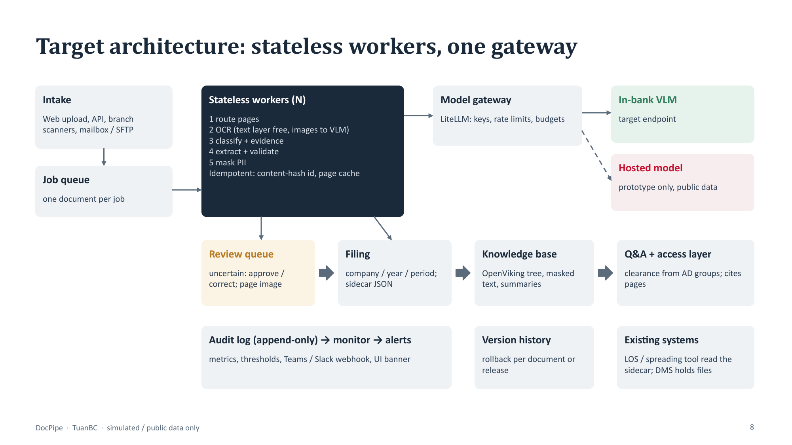
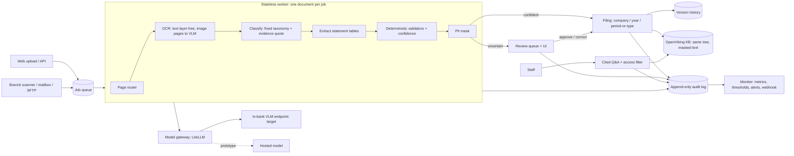

# Architecture, key decisions and trade-offs

DocPipe takes scanned or digital documents for corporate credit (financial statements, annual reports,
registration certificates, contracts, invoices, collateral papers, resolutions, tax filings, bank statements),
reads them with a vision model, files them into a predictable folder tree, publishes a masked copy to a knowledge
base, and answers staff questions with page citations. Anything it is not sure about goes to a human first.
Prototype data: public filings and synthetic scans of fictional companies only.

## 1. Target architecture (what a bank would run)

| Concern | Design in the prototype | At bank scale |
|---|---|---|
| Thousands of users | Ingestion runs through one background worker per process; reads (library, Q&A) are served directly. Each document is independent and idempotent (content-hash id, per-page cache). | N stateless workers behind a queue, one document per job; the gateway enforces per-team rate limits and budgets. Review UI and Q&A scale separately from ingestion, so one cannot starve the other. |
| Existing systems | Integration is the filed folder plus a sidecar JSON: every field, its source page, its checks, the decision, the model and pipeline version. | A loan-origination or spreading system reads the sidecar or a REST call; DocPipe never becomes the system of record. The folder tree maps onto the bank's document-management system. |
| Data classification | Every document is tagged `internal` or `restricted` (PII found in what is published). Originals and the PII mapping stay in a restricted local store; the KB only receives masked text. | Classification drives storage location, retention and who may query. |
| Access control | Q&A filters chunks by the caller's clearance before the model sees them; a restricted chunk never reaches an internal user (tested). | Clearance from the bank's identity provider (AD groups), enforced in our access layer, not delegated to the KB vendor. |
| Audit trail | `audit.jsonl`: every model call (model, prompt hash, tokens, latency, raw response), check, decision, approval, correction, rollback, alert and kill-switch change, with actor and time. | Shipped to the bank's log platform (append-only, retention policy); the same events feed dashboards. |
| Safe re-run, rollback | Re-runs are idempotent; every replaced filed version is kept in `_history/`; `docpipe rollback <doc>` or `--release <version>` restores and re-publishes, and is itself reversible. | Same, with history in object storage. |
| Monitoring | `docpipe/monitor.py`: review rate, queue age, validator failure rate, schema-invalid replies, model errors, p95 latency, cost per document, KB publish errors, "auto-filed then corrected"; thresholds in config; alerts to file, audit log, UI banner and an optional webhook. | Same rules in the bank's monitoring stack, with an on-call rota for critical alerts. |

## 2. The controls that make a model output trustworthy

Nothing the model returns is trusted on its own. In the order they run:

1. **Page router**: only statement pages go to table extraction (cost and risk control); a 111-page annual report costs 3 pages.
2. **OCR policy**: text-layer pages are read for free; image pages go to the VLM (cached, capped per document so a 300-page scan cannot run up a bill).
3. **Fixed taxonomy + evidence**: the classifier must quote the text that proves the document type and name the bank's *customer* (borrower, buyer, account holder), never the bank, the auditor or a government office.
4. **Evidence checks for documents without tables**: the quoted evidence and the company name must actually appear in the OCR text; otherwise the document goes to review.
5. **Schema validated locally** with a bounded retry (provider-side schema enforcement did not work on the subscription route).
6. **Deterministic validators for statements**: balance identities, current + non-current, gross and net profit, cash roll-forward, unit consistency, and "every number must be printed on the page".
7. **Two-pass agreement** on scanned statement pages: an independent second read; any disagreeing value fails.
8. **Confidence from signals**: each failed check halves the confidence; below the threshold, outside the taxonomy, or with the kill switch on, the document goes to review.

## 3. Key decisions and trade-offs

The three decisions that shape cost, speed and risk most:

| # | Decision | Gain | Price (cost / speed / risk) | How the loss is limited |
|---|---|---|---|---|
| 1 | **Vision model for OCR, not an OCR engine + layout rules** | One call reads Vietnamese diacritics, stamps, skewed photos and tables; no per-template tuning. Measured on 16 synthetic scans: 106/106 printed amounts and codes exact, median CER 0.013. | Cost ~$0.0013 per document at list price; ~13 s per document; risk: the model can invent text (it added a table header and a stamp description that were not printed) or drop a digit, and page images leave the bank on a hosted route. | Validators, evidence checks, two-pass agreement on statements, review queue; an in-bank endpoint is a gate before any non-public document. The text layer is used for free whenever it exists. |
| 2 | **Deterministic checks + human review decide, not the model's confidence** | Every auto-filed result passed checks we wrote and can explain to an auditor; failures are visible and countable. | Speed: some correct documents wait for a reviewer (false alarms were real on new issuer layouts). Cost: reviewer minutes. | Reviewers see the page next to the value; thresholds tuned on pilot data; the review rate is a monitored metric with an alert. |
| 3 | **OpenViking for the knowledge base, behind an adapter, with our own access layer** | Its `viking://` tree mirrors the folder design, it writes per-document summaries, and it ranks whole documents well; agents can use it over MCP. | Risk: AGPL-3.0 licence, young project, RBAC not verified; summaries cost a model call per document (~40 s). | Adapter keeps it swappable (a local BM25 fallback is built and used on outage); page citations and access filtering stay in our code; legal review before production. |

Smaller decisions: a fixed taxonomy instead of topic discovery (auditable labels; BERTopic stays an offline tool);
PII masking with local regex today, local NER next, in-bank model as the real barrier (section 4); the ChatGPT
subscription route through LiteLLM for the demo only (spend shows as $0, so cost is computed from measured tokens
x list price).

## 4. Privacy by design: the ladder

A hosted model sees page images, and a text guardrail cannot mask an image, so privacy is a ladder, not a switch.

| Level | What | Protects the first hop? | State |
|---|---|---|---|
| L1 | Local regex recognizers for Vietnamese ID numbers, phones, e-mails; masked before the KB | Text calls only | Built, measured (`evals/pii_eval.py`) |
| L2 | L1 + local Vietnamese NER for names and addresses | Text calls only | Not built (regex misses names: known gap) |
| L3 | In-bank VLM endpoint (or local OCR, mask, then LLM) | Yes, including images | Gate before pilot |

Legal context (secondary sources, to confirm with legal): Personal Data Protection Law 91/2025/QH15 and Decree
356/2025/ND-CP require an impact assessment for cross-border transfers of personal data; Circular 53/2026/TT-NHNN
says outsourcing an AI component does not shift responsibility.

## 5. What it does not do (on purpose)

No credit decisioning, no fine-tuning, no analytics warehouse, no replacement of the document-management or
loan-origination system, no unsupervised filing of documents outside the taxonomy.

## 6. Status of the stack

| Component | State |
|---|---|
| Pipeline: router, OCR, classification, extraction, validators, two-pass, PII mask, filing, review, correction, kill switch, audit | Working, measured (`docs/eval-results.md`) |
| Monitoring + alerts, version history + rollback | Working, unit-tested, demonstrated on real output |
| OpenViking 0.5.3 server, LiteLLM proxy, embedding endpoint | Running natively; documents published under `viking://resources/docpipe/{company}/{year}/{period-or-type}/` |
| Web UI (inbox, library, review, knowledge base, system) | Working (`docpipe serve`) |
| Langfuse, Presidio, container compose | Config written in `deploy/`, not run (containers do not start on the dev machine) |
