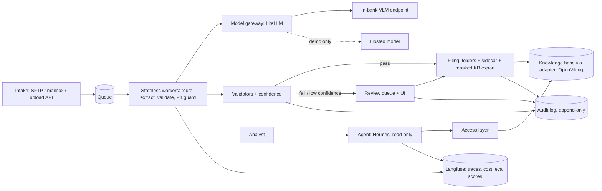

# Architecture, key decisions and trade-offs

Scope: corporate-credit document intake. Financial statements and annual reports go in; filed, validated,
searchable knowledge comes out. Public documents only in the prototype.

## 1. Target architecture (what a bank would run)

| Concern | Design |
|---|---|
| Scale to thousands of users | Workers are stateless and idempotent (content-hash keyed, per-page cache), so they scale horizontally behind a queue. The gateway enforces rate limits and per-component keys. Review and Q&A are separate paths from ingestion, so one cannot starve the other. |
| Existing systems | Integration is through the filing step: a folder layout plus sidecar JSON with every value, its source page and its checks. A credit system or spreading tool reads the sidecar; nothing replaces the system of record. |
| Security / privacy | Data classification on every document (`internal` / `restricted`). The KB indexes PII-masked text; originals and the PII mapping sit in a restricted store. The agent is read-only and sees masked text unless the user is cleared. See section 3. |
| Auditability | `audit.jsonl` (target: append-only store) records every model call (model, prompt hash, tokens, latency, raw response), every validator result, every decision, every human correction. A filed value can be traced to a page and replayed. |
| Failure and rollback | Idempotent re-run, page cache for resume, kill switch (flag file) that sends everything to review, reviewer correction that re-validates and re-files. Re-filing removes the earlier copy of the same document. |

## 2. The controls that make a model output trustworthy

Nothing the model returns is trusted by itself. Controls, in the order they run:

1. **Router**: only statement pages go to extraction (a cost and risk control). Text-layer pages are routed by title and numeric density; pages without a text layer are classified by a cheap low-resolution call.
2. **Schema in the prompt, validated locally** with a bounded retry; provider-side schema enforcement did not work on the subscription route (`docs/day1-findings.md`).
3. **Evidence per value**: each item carries the printed row text.
4. **Deterministic validators**: balance identities, current + non-current, gross profit, net profit, cash roll-forward, net change = operating + investing + financing, cash tie-out between statements, unit presence and consistency, and "every number must be printed in the page text layer".
5. **Two-pass agreement** where there is no text layer: an independent re-read (different prompt and resolution); any disagreeing value fails the check.
6. **Confidence from signals**: each failed check halves the document confidence. The model's own confidence is only used for document type.
7. **Decision**: below threshold, kill switch, or type outside the taxonomy goes to the review queue.

Measured behaviour is in `docs/eval-results.md`.

## 3. Privacy by design: the ladder

A hosted model sees page images. A text guardrail cannot mask an image, so privacy is a ladder, not a switch.

| Level | Detector | Where | Protects the first hop? | State |
|---|---|---|---|---|
| L0 | Luna flags PII in the transcript | Hosted provider | No (image already sent) | Built, measured (seeded synthetic lines) |
| L1 | Regex recognizers for Vietnamese IDs, phones, emails | Local | Yes for text calls | Built in `docpipe/pii.py`; Presidio version in `deploy/` is untested |
| L2 | L1 + local Vietnamese NER for names and addresses | Local, CPU | Yes for text | Not built |
| L3 | In-bank VLM endpoint, or local OCR then mask then LLM | In-bank | Yes, including images | Target for pilot |

Presidio has no built-in Vietnamese recognizers or NLP model, so L1 needs custom recognizers and L2 needs a Vietnamese NER model.

Legal context (public, secondary sources, not read in full text): Personal Data Protection Law 91/2025/QH15 and Decree
356/2025/ND-CP (from 1 Jan 2026) require an impact assessment filed with the authority for cross-border transfers of
personal data; Circular 53/2026/TT-NHNN on AI in banking says outsourcing does not shift responsibility. The
documents in this prototype are public company filings; a production corpus will contain personal data, so the
in-bank endpoint is a gate before pilot, not an optimisation.

## 4. Key decisions and trade-offs

| # | Decision | Gain | Price | How the loss is limited |
|---|---|---|---|---|
| 1 | VLM instead of OCR + rules | One call; reads Vietnamese tables with diacritics; no OCR tuning. The PDF text layer scrambles table order (labels and numbers come out in separate blocks), so text extraction alone cannot rebuild a statement. | Hallucinated or dropped digits; no per-field confidence; images leave the bank | Validators, text-layer check, two-pass agreement, review queue; in-bank endpoint before pilot |
| 2 | Fixed taxonomy + LLM classifier, not BERTopic | Auditable labels; anything else goes to review | Cannot discover new categories | BERTopic stays an offline discovery tool |
| 3 | OpenViking behind an adapter | Its `viking://` filesystem matches the folder design; MCP access for the agent | AGPL-3.0 (verified in the repo's LICENSE); RBAC unverified; single-vendor governance | Adapter keeps it swappable; our own access layer; legal review before production |
| 4 | Detector placement for PII | Hosted is simple; local is a real barrier | Hosted detection is not a barrier; regex misses names | The ladder; measured precision and recall |
| 5 | Model route for the demo: ChatGPT subscription through LiteLLM | Zero marginal cost, one gateway | Spend recorded as $0 (no budget enforcement), one shared identity, quota owned by OpenAI, ToS for shared use unchecked, no embeddings, schema not enforced | Cost computed from measured tokens x list price; rpm/tpm limits; production uses a priced, contractual endpoint |

## 5. What this does not do

No credit decisioning, no fine-tuning, no analytics database, no replacement of a core system. A statement type
outside the validator patterns still gets extracted and filed, but its arithmetic checks skip instead of failing.

## 6. Status of the stack

| Component | State |
|---|---|
| docpipe (router, extraction, validators, two-pass for scans, PII guard, filing, review, correction, kill switch, audit) | Working natively; measured in `docs/eval-results.md` |
| KB (local BM25 backend with access filter) and cited Q&A (`docpipe ask`) | Working; dense embeddings could not load on the dev machine (commit limit), so retrieval is BM25-only |
| LiteLLM as SDK (model calls) | Working |
| LiteLLM proxy + OpenViking server + Copilot embedding shim, native | Run: gateway served the Q&A call; 4 masked documents ingested with real embeddings; document-level retrieval measured (eval-results 7d) |
| Langfuse, Presidio, TEI embeddings, container compose | `deploy/` files written, **never run**: Podman/WSL does not start on the dev machine |
| Hermes agent over the KB | Not run by me; the user reports it working with the OpenViking MCP server |
| Langfuse callback | Wired through LiteLLM metadata and an env switch; not tested against a server |
